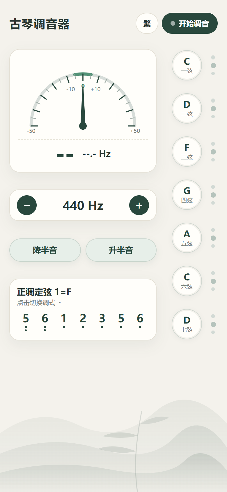
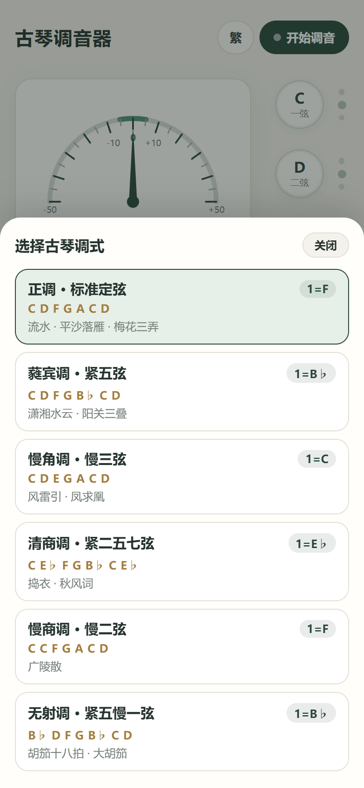
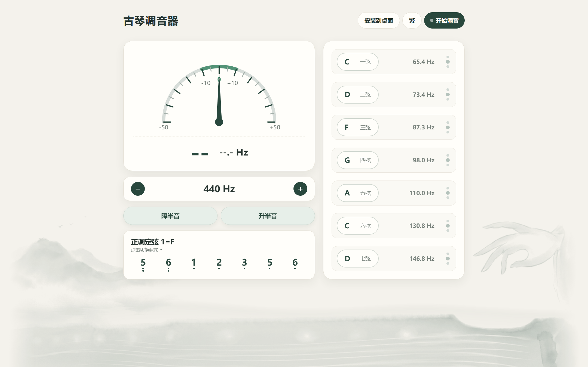

# 古琴调音器

<p align="center">
  
</p>

手机上的通用调音器拿来调古琴，一弦和二弦经常抓不准。古琴一弦散音 `C2` 只有 `65.4 Hz`，手机麦克风录进来基频很弱，算法很容易把它误判成高八度的泛音，指针跟着乱跳。

这个调音器就是为了解决这件事做的。界面按宣纸和墨绿的配色来，提供 **Android 离线安装包**、**PWA 网页版** 和 **单文件便携版** 三种用法，装好或者缓存一次就能断网使用。

<p align="center">
  
  &nbsp;&nbsp;&nbsp;&nbsp;
  
</p>

<p align="center">
  
</p>

## 它做了什么

**低频防八度误判**，采用 MPM（McLeod Pitch Method）音高检测算法，专门针对 `C2` 这类低音弦做倍频抑制，检测下限覆盖至 `30 Hz`，配合音高平滑和 `1500 ms` 尾音保持，拨完弦能稳住读数。

**六种传统调式与移调**，内置正调、蕤宾调、慢角调、清商调、慢商调和无射调，同时列出七弦散音音名、目标频率和简谱。`A4` 基准音支持 `240 Hz ~ 640 Hz`（`440 ± 200 Hz`）大范围调节，两侧按钮支持短按微调与长按连续加速、点击数值一键复位 `440 Hz`；整体支持 `-6 ~ +6` 半音移调，偏差落在 `±10` 音分以内即为准音。

**宣纸墨韵与多端离线**，底部配有淡墨绿没骨山水抚琴水墨底图，大屏与小屏分别采用独立构图；右上角可一键切换简体中文和繁体中文，连击左上角标题「古琴调音器」5 次可呼出「关于」弹窗查看版本号、作者与更新日志。Android 端通过 `WebViewAssetLoader` 映射本地安全源并原生申请麦克风权限，调音期间自动保持屏幕常亮；网页版自带 Service Worker（`sw.js`），添加到桌面后一样可以离线打开。


## 支持的传统调式

| 调式 | 调高 | 七弦散音（一弦至七弦） | 常见说明 |
| :--- | :--- | :--- | :--- |
| 正调 | `1=F` | `C D F G A C D` | 最常用标准定弦 |
| 蕤宾调 | `1=B♭` | `C D F G B♭ C D` | 紧五弦 |
| 慢角调 | `1=C` | `C D E G A C D` | 慢三弦 |
| 清商调 | `1=E♭` | `C E♭ F G B♭ C E♭` | 紧二、五、七弦 |
| 慢商调 | `1=F` | `C C F G A C D` | 慢二弦（一、二弦同音） |
| 无射调 | `1=B♭` | `B♭ D F G B♭ C D` | 慢一、紧五弦 |

## 怎么用

### 1. Android 手机直接安装

下载仓库根目录的 `guqin_tuner.apk` 安装即可，系统需要 Android 7.0（API 24）及以上。装好后点击右上角「开始调音」，授予麦克风权限就能用。

### 2. 电脑本地网页运行

浏览器只有在 `https://` 或 `http://localhost` 这类安全上下文里才允许调用麦克风，不要直接用文件管理器以 `file://` 打开页面。在项目根目录起一个本地静态服务即可

```bash
python -m http.server 8000
# 或者用 Node.js
npx serve .
```

服务跑起来后，打开 `http://localhost:8000/` 是模块化版，打开 `http://localhost:8000/guqin_tuner.html` 是单文件便携版。

### 3. 自行编译 Android APK

本机装有 Android Studio 或 Android SDK（JDK 17 及以上）的话，可以直接用 Android Studio 打开 `android/` 目录构建，或者在命令行运行

```bash
cd android
gradle assembleDebug --no-daemon
```

打出来的包在 `android/app/build/outputs/apk/debug/app-debug.apk`。仓库里也配了 `.github/workflows/build-apk.yml`，推到 GitHub 后会自动触发云端编译。

## 运行测试

单元测试直接用 Node.js 内置测试运行器，不依赖第三方测试库

```bash
npm test
```

用例覆盖六种传统调式定义、`240 ~ 640 Hz` A4 基准与移调边界、`±10` 音分准音判定、同音弦匹配、低频 MPM 防八度误判、音高平滑逻辑及简繁词条完整性。

## 目录结构

```text
guqin_tuner/
├── index.html                  # 网页模块化版入口
├── style.css                   # 宣纸墨绿国风响应式样式
├── sw.js                       # PWA 离线缓存 Service Worker
├── manifest.webmanifest        # PWA 应用清单
├── guqin_tuner.html            # 单文件便携版（HTML/CSS/JS 与底图全内联）
├── guqin_tuner.apk             # 预编译 Android 离线安装包
├── assets/                     # 大小屏透明没骨水墨底图（WebP）
├── docs/images/                # README 界面预览截图
├── icons/                      # 网页与 PWA 图标资源
├── src/
│   ├── app.js                  # 主界面交互与状态管理
│   ├── audio.js                # Web Audio 麦克风采集封装
│   ├── pitch.js                # MPM 低频音高检测与平滑器
│   ├── tunings.js              # 古琴六调式与频率/音分引擎
│   └── i18n.js                 # 简繁中文词条与版本日志
├── tests/                      # 单元测试
├── android/                    # Android 原生 WebView 壳工程（含自适应图标）
└── .github/workflows/          # GitHub Actions 云端编译 APK 工作流
```

## 致谢

感谢子潇提供的底图。

## 开源许可

本项目基于 [MIT License](LICENSE) 开源。
